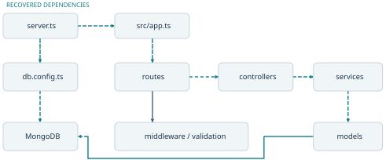
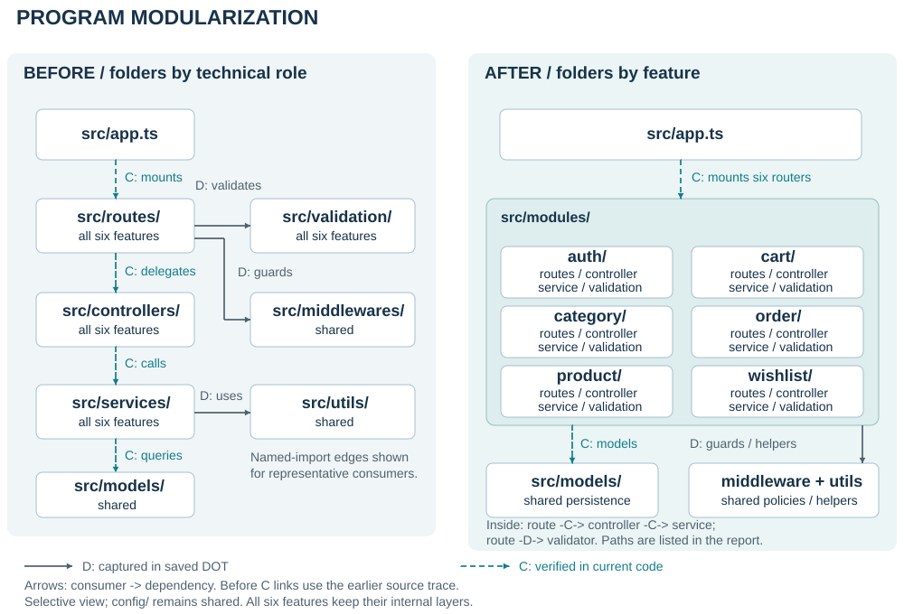

# Software Reengineering

## Stages 1-4: An Evidence-Based Backend Study

**Students:**  
عبدالله فهيم عمله  
منة الله حسام خلف

### Abstract

This report documents four completed software reengineering stages in an Express backend: Source Code Translation, Reverse Engineering, Program Structure Improvement, and Program Modularization. Migration artifacts support the transition from JavaScript to TypeScript. Source tracing establishes the application's startup sequence, request handling, and access controls. Preserved clone fragments and duplication reports support the extraction of a shared authentication error handler. Earlier and later dependency exports, together with the current source, establish the relocation of 24 files into six feature modules.

The findings show a progression from language translation to program comprehension, targeted refactoring, and feature-based organization. The **Re-engineered Program** is the primary Stage 4 output; code examples, measurements, architecture views and verification records provide supporting evidence.

### Scope and evidence method

The inspection covered `package.json`, `tsconfig.json`, `server.ts`, `src/app.ts`, feature modules, shared components, and saved analysis reports. Claims are classified as **source-verified**, **saved tool output**, **executed verification**, or **user-reported**. References [E1-E7] identify the supporting files in the single evidence appendix.

Current paths use the feature-based layout under `src/modules/`. Earlier paths are explicitly labelled as historical and are supported by the pre-move dependency export or preserved source fragments. This distinction separates the earlier stages from the program's final organization. The original individual reports remain available as historical records.

### Organization

1. Source Code Translation: migration artifacts, compiler configuration, and a real TypeScript example.
2. Reverse Engineering: startup, a login request trace, architecture, and representative endpoints.
3. Program Structure Improvement: `sendAuthError`, response preservation, and duplication results.
4. Program Modularization: directory changes, file mapping, relocation method, and dependency comparison.

The final sections record the tools, verification results and supporting evidence. Credentials, tokens, environment values, and real user data are excluded.

<!-- pagebreak -->

## 1. Source Code Translation

### Objective and tools

The translation stage moved the JavaScript Express backend to TypeScript while retaining its CommonJS execution model. `package.json` declares `@obiemunoz/ts-migrate` at `^0.20.3`, TypeScript at `^6.0.3`, and `tsx` at `^4.23.15`. The installed migration package identifies itself as version `0.20.3`; its local README describes initialization, file renaming, migration codemods, and compiler checking. [E1]

### Migration evidence and configuration

`tsconfig.json` begins with a ts-migrate generation marker. `types/ts-migrate-modules.d.ts` also identifies itself as generated by that tool. Explicit annotations, `any`, type assertions, and `@ts-expect-error` comments are consistent with a staged automated migration. The exact migration invocation and original JavaScript sources are unavailable; the migration was not rerun for this report.

| Configuration | Observed setting and purpose |
| --- | --- |
| Target and modules | `target: esnext`; `module: commonjs`; `moduleDetection: force` |
| Strictness and interoperability | `strict: true`; `esModuleInterop: true` |
| Staged compatibility | `allowJs: true`; `resolveJsonModule: true` |
| Compiler checks | `skipLibCheck: true`; consistent filename casing enforced |
| Explicit types | Includes `node`, `express`, and associated HTTP types |
| Other settings | `jsx: react`; no explicit `include`, `exclude`, `outDir`, or `noEmit` |

The development command is `npm run dev`, defined as `nodemon --exec tsx server.ts`. Nodemon manages restarts, and `tsx` transforms and executes TypeScript at runtime. This is separate from full compiler checking. The actual development entry point is `server.ts`; package metadata still lists `main: server.js`. No build or production-start script is declared. [E1]

### Real TypeScript example

The following current excerpt comes from `src/utils/hash.utils.ts`. No original `hash.utils.js` snapshot is available, so a historical before-and-after translation cannot be established. [E3]

```typescript
const comparePassword = async (password: string, hashedPassword: string) => {
    return await bcrypt.compare(password, hashedPassword);
};
```

The parameter annotations add compile-time constraints; runtime input validation remains a separate middleware responsibility. Ambient declarations for `cors`, `hpp`, and `jsonwebtoken` permit those modules to type as `any`, and suppression comments remain elsewhere. Passing the compiler therefore demonstrates acceptance under this configuration rather than complete type safety.

### Output and verification

The output is a TypeScript backend, migration-generated configuration and declarations, and a development execution command. The recorded `tsc --noEmit` check passed, and an isolated `tsx` startup check loaded the actual modules successfully. The unified verification record explains those checks and their limits; neither proves equivalence with the unavailable original JavaScript program. [E6]

<!-- pagebreak -->

## 2. Reverse Engineering

### Objective and tools

Reverse engineering recovered the application's structure and behavior through source inspection and saved dependency-cruiser exports. The composition root is `src/app.ts`; feature routes, controllers, services and validators now reside under `src/modules/`. Configuration, models, middleware and utilities remain shared. The file-level inventory is documented in Stage 4. [E1-E5]

### Startup and MongoDB initialization

`server.ts` loads dotenv, imports `connectDB`, `app`, and `PORT`, and calls `startServer`. `src/config/env.config.ts` also invokes dotenv, maps `process.env.DBConnection` to `DB_CONNECTION`, and requires `DB_CONNECTION`, `JWT_SECRET`, and `CLIENT_URL`. `PORT` is read but is not part of that required-variable check. Only names are recorded here.

Within `startServer`, `await connectDB()` precedes `app.listen(PORT, ...)`. `src/config/db.config.ts` awaits `mongoose.connect(DB_CONNECTION)` and exits with code 1 after a connection failure. Startup has its own catch-and-exit path; import-time configuration exceptions can occur before that try block. [E1, E3]



**Figure 1.** Arrows point from a consumer to its dependency. Solid arrows are represented in the saved exports; dashed arrows add code-verified relationships omitted there. The database arrows indicate connection or query use. This selective role-level view omits feature containers, which appear in Figure 2. [E1-E5]

### Code-verified request trace: `POST /api/auth/login`

1. `src/app.ts` installs Helmet, `cors()`, JSON parsing and HPP, then mounts Auth at `/api/auth`. The generic `/api/` limiter is registered afterwards, so a completed login response does not pass through it.
2. `src/modules/auth/auth.routes.ts` registers `/login` with `authLimiter`, `validateLogin`, and `authController.login`. The limiter permits five requests per minute and skips successful requests.
3. `validateLogin` in `auth.valedation.ts` checks the body, normalizes supported Jordanian phone formats, trims the password, and assigns `{ phone, password }`. Invalid input goes to `next(error)` with status 400.
4. `AuthController.login` calls `authService.login(req.body)`. `AuthService.login` queries `User.findOne({ phone }).select('+password')` and calls `comparePassword`, which delegates to `bcrypt.compare`. Rejected credentials raise a 401 error.
5. A successful match calls `generateToken`, reads `User.findById(...).select('-password').lean()`, and returns `{ user: safeUser, token }`. The controller sends `success`, `message`, and `data` using the normal HTTP 200 default. Service errors use `sendAuthError`; validation errors reach the global error handler.

These statuses are derived from source, not captured Postman responses. The final middleware handles unmatched requests with 404 and handles propagated errors separately. [E2, E3]

<!-- pagebreak -->

### Representative mounted endpoints

Paths below combine the mounts in `src/app.ts` with the local route declarations. Access requirements are source-verified; the table is representative rather than exhaustive. A trailing `/` indicates a router's root. [E1-E3]

| Method | Full mounted path | Verified authentication requirement |
| --- | --- | --- |
| GET | `/` | Public |
| POST | `/api/auth/login` | Public; Auth limiter and login validation |
| POST | `/api/auth/register` | Public; Auth limiter and registration validation |
| POST | `/api/auth/logout` | Bearer authentication |
| GET | `/api/auth/` | Bearer authentication |
| PUT | `/api/auth/` | Bearer authentication; profile validation |
| PUT | `/api/auth/update/:id` | Bearer authentication and `admin` role |
| GET | `/api/category/` | Public |
| GET | `/api/category/:id` | Public; ID validation |
| POST | `/api/category/` | Bearer authentication and `admin` role |
| GET | `/api/product/` | Public |
| GET | `/api/product/:id` | Public; ID validation |
| POST | `/api/product/` | Bearer authentication and `admin` role |
| GET | `/api/cart/` | Bearer authentication on the whole router |
| POST | `/api/cart/items` | Bearer authentication; item validation |
| PATCH | `/api/cart/items/:itemId` | Bearer authentication; ID and quantity validation |
| POST | `/api/order/` | Bearer authentication; order validation |
| GET | `/api/order/my` | Bearer authentication |
| GET | `/api/order/admin/all` | Bearer authentication and `admin` role |
| PATCH | `/api/order/admin/:orderId/status` | Bearer authentication and `admin` role |
| GET | `/api/wishlist/` | Bearer authentication on the whole router |
| POST | `/api/wishlist/items` | Bearer authentication; product validation |
| DELETE | `/api/wishlist/items/:productId` | Bearer authentication; product-ID validation |

`authMiddleware` requires an `Authorization` header beginning with `Bearer `, invokes `verifyToken`, resolves `decoded.userId || decoded.UserId`, and loads a password-excluding User record. Missing or invalid authentication produces a source-defined 401 response. `authorize(['admin'])` checks the role and returns 403 when a present user's role is not permitted. Category and Product writes apply these checks per route; Cart, Order and Wishlist apply authentication at router level. [E3]

### Output and verification

Stage 2 produced a recovered startup sequence, request trace, access-control inventory, and architecture view. Verification used source tracing and comparison with saved exports. Export omissions are reconciled once in the dependency comparison in Stage 4. No database-backed endpoint or role-based request was executed during the inspection. [E5, E6]

<!-- pagebreak -->

## 3. Program Structure Improvement

### Objective, tools and change

This stage consolidated repeated authentication error responses into `sendAuthError`. The controller was originally `src/controllers/auth.controller.ts` and now resides at `src/modules/auth/auth.controller.ts`. Its `login`, `register`, `logout`, `updateMe`, and `update` catches use the helper; `getMe` retains its direct missing-user check. The refactor was recorded as applied through PowerShell. Saved `jscpd` reports provide the quantitative evidence. [E2, E4, E7]

**Before:** the earlier report preserves this real TypeScript fragment in a clone beginning at line 18 of `controllers\auth.controller.ts`. Indentation is normalized; a complete historical file is unavailable. [E4]

```typescript
} catch (error) {
  return res.status(getStatusCode(error)).json({
    success: false,
    message: (error as any).message,
    error: (error as any).message
  });
}
```

**After:** each catch returns `sendAuthError(res, error)`. The helper's response statement is:

```typescript
return res.status(getStatusCode(error)).json({
  success: false,
  message: error.message,
  error: error.message
});
```

Both versions delegate to `getStatusCode`. The current resolver applies `Number(error?.statusCode ?? error?.status)`, accepts integers from 100 through 599, and otherwise returns 500. A non-nullish `statusCode` takes precedence; an invalid one falls back to 500 rather than trying `status`. The JSON fields remain `success: false`, `message`, and `error`, with both message fields taken from `error.message`. Removing a TypeScript assertion has no runtime effect. The old fragment does not preserve the resolver's full historical definition. [E2, E4]

### Measured output

| Metric | Before | After | Change |
| --- | --- | --- | --- |
| TypeScript files scanned | 40 | 40 | Unchanged |
| Detected clones | 50 | 44 | 6 fewer |
| Duplicated lines | 569 | 498 | 71 fewer |
| Duplicated line rate | 24.36% | 21.40% | 2.96 percentage points lower |
| Total source lines | 2,336 | 2,327 | 9 fewer |

The displayed rate difference is **24.36 - 21.40 = 2.96 percentage points**; total source size fell by **2,336 - 2,327 = 9 lines**. Clone accounting differs from net source length, explaining why fewer duplicated lines do not imply an equal reduction in file length. These are saved Stage 3 measurements, not fresh Stage 4 scans. Their interpretation does not establish that the helper alone caused every repository-level difference.

### Verification

Both local reports match the table and their clone-array totals. Source inspection confirms the helper and its five call sites. Valid/invalid login checks are user-reported; compiler and isolated startup results are recorded centrally in the verification section. [E4, E6, E7]

<!-- pagebreak -->

## 4. Program Modularization

### Objective and structural result

Stage 4 groups feature-specific routes, controllers, services and validators into Auth, Cart, Category, Order, Product and Wishlist modules. Related files become easier to follow within one directory, while shared infrastructure stays outside the feature folders. The primary output is the **Re-engineered Program**: the backend with its feature modules, corrected references and application composition. The report, diagram and dependency exports support that output. [E1-E3]

### Before: folders grouped by technical role

The old paths are evidenced by `dependencies-before.dot`. Auth illustrates the naming pattern; the next page gives the complete feature inventory. [E5]

```text
server.ts
src/
  app.ts
  routes/       auth.routes.ts, ...
  controllers/  auth.controller.ts, ...
  services/     auth.service.ts, ...
  validation/   auth.valedation.ts, ...
  models/       seven shared model files
  config/       db.config.ts, env.config.ts
  middlewares/  four shared middleware files
  utils/        hash.utils.ts, jwt.utils.ts
```

### After: folders grouped by feature

```text
server.ts
src/
  app.ts
  modules/
    auth/       routes, controller, service, validation
    cart/       routes, controller, service, validation
    category/   routes, controller, service, validation
    order/      routes, controller, service, validation
    product/    routes, controller, service, validation
    wishlist/   routes, controller, service, validation
  models/       seven shared model files
  config/       db.config.ts, env.config.ts
  middlewares/  four shared middleware files
  utils/        hash.utils.ts, jwt.utils.ts
```

Models remain at `src/models/{user,cart,category,order,product,review,wishlist}.model.ts`. Shared middleware remains at `src/middlewares/{auth,error,notFound,rateLimit}.middlewares.ts`. The braces expand to exact filenames; the code retains the existing `valedation` spelling where applicable. [E3]

The old export also lists `src/routes/user.routes.ts`, previously observed as empty and unmounted. It is absent now and is not one of the 24 mapped files. The review model remains shared without a mounted review router. No claim is made about the exact command that removed the empty route file. [E5]

<!-- pagebreak -->

### Verified module inventory

Each filename below now resides in the destination shown. Before the move, `.routes.ts` files lived in `src/routes/`, `.controller.ts` in `src/controllers/`, `.service.ts` in `src/services/`, and validation files in `src/validation/`. All 24 mappings are present in the old/new exports and in `04-audit-evidence.json`; the corresponding old paths no longer exist. [E2, E5, E6]

| Module and destination | Exact files moved | Responsibilities |
| --- | --- | --- |
| Auth: `src/modules/auth/` | `auth.routes.ts`; `auth.controller.ts`; `auth.service.ts`; `auth.valedation.ts` | Login, registration, logout, profile/admin updates, input checks, and password/JWT helper use. |
| Cart: `src/modules/cart/` | `cart.routes.ts`; `cart.controller.ts`; `cart.service.ts`; `cart.valedation.ts` | Cart retrieval, item addition/update/removal, clearing, ID/quantity validation, and stock checks. |
| Category: `src/modules/category/` | `category.routes.ts`; `category.controller.ts`; `category.service.ts`; `category.validation.ts` | Category retrieval and CRUD, duplicate-name checks, and protection against deleting referenced categories. |
| Order: `src/modules/order/` | `order.routes.ts`; `order.controller.ts`; `order.service.ts`; `order.validation.ts` | Orders from carts, item/customer snapshots and totals, cart clearing, personal/admin listings, and status updates. |
| Product: `src/modules/product/` | `product.routes.ts`; `product.controller.ts`; `product.service.ts`; `product.valedation.ts` | Product retrieval, administrator CRUD, category population, and ID/price/stock validation. |
| Wishlist: `src/modules/wishlist/` | `wishlist.routes.ts`; `wishlist.controller.ts`; `wishlist.service.ts`; `wishlist.validation.ts` | Wishlist retrieval, product addition/removal/clearing, duplicate avoidance, and product/category population. |

### Recorded relocation method

The user's account assigns distinct roles to PowerShell, Node.js, ts-morph and the TypeScript compiler API. PowerShell hosted the command; Node.js ran the script and performed the filesystem and reference edits. The recorded process was:

1. Load the project and compiler settings with ts-morph.
2. Use the TypeScript compiler API to find and resolve relative references, including imports, `import X = require(...)`, and literal `require(...)` calls.
3. Map each feature's files to `src/modules/<feature>/`, move them with Node.js, and rewrite both inbound references and references inside moved files.
4. Type-check the result, perform the reported Auth checks, and save the post-move dependency export.

The original script and transcript are unavailable. This is therefore a recorded workflow corroborated by the result, not an exact recovered command sequence. The new read-only audit loads the current project with `Project` and resolves references with `ts.resolveModuleName`; it does not relocate code. [E6, E7]

<!-- pagebreak -->

### Before-and-after dependency architecture



**Figure 2.** Arrows point from a consumer to a dependency. **D / solid** denotes representative relationships captured by the saved dependency-cruiser export. **C / dashed** adds current code-verified relationships; their before-move counterparts are reconstructed from the earlier source trace. Boxes group files, not separate processes. [E2, E5]

### Reference updates and export reconciliation

`src/app.ts` now imports Auth from `./modules/auth/auth.routes`. Within Auth, the router imports `./auth.controller` and `./auth.valedation`; the controller imports `./auth.service`; the service reaches the shared User model through `../../models/user.model`. The other five features follow the same local/shared reference pattern. [E1-E3]

The exports each contain **26 directed edges**, with matching edge sets after the verified path substitutions. This supports continuity of the captured dependencies, but both exports omit important relationships. For example, the after export omits App-to-Auth-router, router-to-controller, controller-to-service, and service-to-User-model imports that the source confirms.

The omission pattern aligns with several TypeScript import-equals declarations. Without the original export command and parser diagnostics, the cause remains unconfirmed. Consequently, `no-orphans` graph labels cannot establish that actively imported files are unused. The figure supplements the export rather than claiming to be a complete tool-generated graph. [E5, E6]

### Output, boundaries and verification

The source audit confirmed six mounted routers, 24 mapped files, 56 resolved relative references and no direct cross-feature imports. This is feature locality rather than full isolation: Order still consumes the shared Order, Cart, Product and User models. Compiler and isolated startup checks passed; post-move Auth verification is user-reported. Detailed results appear once in the verification record. [E6, E7]

<!-- pagebreak -->

## Tools Used by Stage

This table records the role of each reengineering tool and the evidence it produced. Availability in `package.json` supports tool presence; it does not alone prove a historical execution. [E1-E7]

| Completed stage | Tool and recorded use | Evidence or output |
| --- | --- | --- |
| 1. Source Code Translation | `@obiemunoz/ts-migrate`: translate JavaScript to TypeScript. TypeScript (`tsc`): check types. `tsx`: run the converted backend. | Generated configuration and declaration markers, TypeScript files, development script, and recorded compiler/startup checks. The original migration execution log is absent. |
| 2. Reverse Engineering | `dependency-cruiser`: analyze dependencies and export DOT. Graphviz: render the existing SVG views separately from dependency analysis. | Before/overview DOT and SVG files. Existing SVG headers identify Graphviz `16.1.0 (20260904.0139)`, verifying rendering provenance without preserving the command transcript. |
| 3. Program Structure Improvement | `jscpd`: measure duplication before/after refactoring. PowerShell: apply the recorded Auth refactor. `tsc`: check types. Postman: check valid and invalid login. | Two saved duplication reports, historical catch fragments and current `sendAuthError`. PowerShell use and Postman results are user-reported; detailed metrics appear in Stage 3. |
| 4. Program Modularization | PowerShell and Node.js: run the move workflow and edit files/references. ts-morph: load the project. TypeScript compiler API: find/resolve references. `tsc`: type-check. Postman: verify Auth. `dependency-cruiser`: export the after graph. | Six feature folders, verified file mapping, current reference audit, successful compiler check, and `dependencies-after.dot`. The move mechanism and Auth Postman result are user-reported where execution artifacts are absent. |

### Local tool and configuration evidence

The inspected installation reports TypeScript `6.0.3`, ts-morph `28.0.0`, `tsx` `4.23.15`, and dependency-cruiser `18.7.2`. These are local installed versions; declared package ranges may differ in meaning from exact versions. The dependency-cruiser configuration identifies generation by version `18.7.2` and leaves pre-compilation dependency collection at its default. [E1, E5, E6]

### Submission production

Python and ReportLab were used to create the PDF and analytical diagrams. Poppler rendered the PDF pages for visual review; the standalone modularization SVG was also rasterized and inspected separately. These are documentation-production tools, separate from the historical reengineering tools above. The new diagrams are analytical reconstructions, not fresh dependency-cruiser output, and were not rendered by Graphviz.

<!-- pagebreak -->

## Verification and Evaluation

### Recorded checks

The checks below were executed during the repository inspections on 10 November 2026. Their results are retained in the audit files and represent the scope of verification available for this report. [E6]

| Check or evidence | Result | What it establishes and its limits |
| --- | --- | --- |
| `node node_modules/typescript/bin/tsc --noEmit --pretty false` | Passed; exit 0, no diagnostics | Acceptance under the current compiler configuration; no JavaScript emitted. Existing `any` and suppression comments remain. |
| `node docs/reengineering/04-audit.cjs` | Passed | Checks the complete move mapping, relative-reference resolution, router mounts, and captured graph correspondence. |
| `node docs/reengineering/verify-evidence.cjs` | Passed | Checks saved metrics and runs isolated startup using real modules, `tsx/cjs`, synthetic configuration and a MongoDB connection stub. |
| Loopback `GET /` in that harness | HTTP 200 | Returns `{"message":"API Running..."}`; verifies the root route and listener in the isolated process. |
| Source test discovery | No suite available | `package.json` declares only `dev`; no source `.test.*` or `.spec.*` files were found. The existing documentation smoke harness was run. |
| Postman login checks | Passed, user-reported | Stage 3: valid and invalid credentials. Stage 4: Auth login after the move. No raw run artifact, exact status, or response body was supplied. |

The startup harness disables dotenv loading, supplies synthetic settings, stubs `mongoose.connect`, binds only to loopback on an ephemeral port, and checks that the connection stub finishes before listening. Its connection log does not demonstrate a live MongoDB connection. The exact development watcher command was inspected but not run. No database-backed login, role test, or comprehensive module test was performed during the inspection.

### Evaluation and remaining evidence gaps

The evidence supports a translated and structurally reorganized backend with compiler acceptance, resolvable references and working isolated application composition. The saved reports support the measured Stage 3 duplication reduction. They do not establish complete behavioral equivalence, independent module deployment, or a measured reduction in maintenance effort.

- No usable Git repository or complete original JavaScript/earlier TypeScript snapshot was available for full historical diffs.
- The migration command, original move script, PowerShell transcript and exact filesystem edit sequence are missing.
- Original dependency-cruiser commands/parser diagnostics and the exact `jscpd` version/configuration were not retained.
- Postman run artifacts, live MongoDB startup, and database-backed checks of the six modules remain unavailable.

<!-- pagebreak -->

## Appendix A. Unified Evidence Register

All paths are relative to the repository root. Brace notation expands to filenames; wildcard notation groups inspected files. Evidence identifiers apply consistently across the four stages.

| ID | Evidence and supported claims |
| --- | --- |
| E1 | `package.json`, `tsconfig.json`, `server.ts`, `src/app.ts`, `types/ts-migrate-modules.d.ts`; installed migration package README. Tool declarations, migration markers, compiler options, startup and router composition. |
| E2 | `src/modules/{auth,cart,category,order,product,wishlist}/`, four files per feature. Exact names, controllers, services, route registrations, validation and current references. |
| E3 | `src/models/*.ts`, `src/config/*.ts`, `src/middlewares/*.ts`, `src/utils/*.ts`. Schemas, shared dependencies, MongoDB initialization, authentication, global errors, hashing and JWT helpers. |
| E4 | `docs/reengineering/structure-before/jscpd-report.json` and `structure-after/jscpd-report.json`. Statistics, clone counts and original Auth catch fragments. Detection timestamps: `2026-11-07T11:12:19.761Z` and `2026-11-07T11:14:47.435Z`. |
| E5 | `.dependency-cruiser.js`; `docs/reengineering/dependencies-before.dot`, `dependencies-after.dot`, `dependencies-overview.dot` and existing before/overview SVGs. Historical/current paths, captured graph relationships and Graphviz rendering headers. |
| E6 | `docs/reengineering/04-audit.cjs`, `04-audit-evidence.json`, `verify-evidence.cjs`, `verification.txt`. Executed compiler, file mapping, reference, graph, saved-metric and isolated startup checks. |
| E7 | User-provided workflow and verification account. Recorded PowerShell refactor and relocation method; Postman valid/invalid login checks and post-move Auth confirmation. |

### Historical source interpretation

The saved Auth clone path starts at `controllers/`, whereas the earlier program used `src/controllers/` and the current program uses `src/modules/auth/`. The original scanner invocation is absent, so its precise working directory and input selection are not assumed. Old route/controller/service/validation paths in the exports establish locations, but do not provide full historical file contents.

### Reproduction and document control

`node docs/reengineering/04-audit.cjs` reproduces the present source/reference/compiler audit. `node docs/reengineering/verify-evidence.cjs` reruns the existing isolated smoke check and saved-metric validation. These commands write evidence under `docs/reengineering/`.

`docs/reengineering/build-unified-report.py` exports this editable Markdown into the submission PDF with continuous page numbering and section bookmarks. Original reports remain separate historical artifacts. This submission covers only the four requested stages and does not modify the re-engineered backend.
